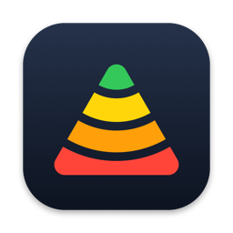

<p align="center">
  
</p>

# DELTA Wi-Fi Analyzer

A native macOS app that measures a home Wi-Fi network **before and after a change** and shows the difference as a heatmap on your floor plans. A [Windows version](#windows-version) lives in the same repository.

DELTA stands for *Difference Evaluation of Latency, Throughput & Attenuation*. Most Wi-Fi tools show signal strength. This one also measures what people actually complain about: packet loss, latency spikes, and real throughput, per room, and then compares two states of the network against each other.

> **Note:** The user interface is in German. The code, identifiers, and this README are in English.

## Why it exists

The app was built to answer one question: did replacing the router and repeaters in a three-storey house make the Wi-Fi better, and where?

The first real survey showed why signal strength alone is not enough. A basement office had −57 dBm and a 650 Mbit/s link rate but only 17 Mbit/s of real throughput, because its repeater reached the router over a weak 2.4 GHz hop. Three rooms with good signal had ping stalls of several seconds. Neither problem shows up on a signal-strength map.

## What it does

- **Floor plans:** Add one image per floor or area (JPG, PNG, HEIC). Floors are yours to name, reorder, and delete.
- **Fixed measurement points:** Place named points on the plan and measure each one. A guided flow moves you to the next open point.
- **Walk surveys:** Walk through the house with the MacBook and click your position on the plan every few metres. The app samples the radio once per second and places each sample by time between your clicks.
- **Heatmaps:** Seven metrics, interpolated across each floor. Areas far from any measurement fade out so you can see where the map is a guess.
- **Phases:** Measure the same points in as many phases as you like, for example "Before", "New router only", and "New router with repeaters".
- **Comparison:** Pick any two phases. The app subtracts one interpolated field from the other and colours the result: green is better, red is worse, grey is unchanged.
- **Analysis:** A summary per phase (median, counts of good, okay, and critical points), a table of all points, and a side-by-side detail view per point.

### What one measurement records

A measurement at a fixed point takes about 1.5 to 2 minutes.

| Step | What is recorded |
|---|---|
| Signal | 10 samples at 1 s intervals, median: RSSI, noise, SNR, link rate, band, channel, channel width, PHY mode, BSSID, SSID |
| Ping, in parallel | 60 pings to the gateway and 60 to `1.1.1.1`: loss, average, and maximum |
| Internet speed test | Download and upload via the built-in `networkQuality` tool (optional) |
| Local throughput | Download and upload via `iperf3` with four parallel streams against a server on your LAN (optional) |

The BSSID is recorded with every measurement and every walk sample. That lets you see which access point or repeater the Mac was connected to at each spot, which turned out to be the key to diagnosing a mesh.

### Metrics and thresholds

| Metric | Good | Okay |
|---|---|---|
| Signal strength | ≥ −60 dBm | ≥ −70 dBm |
| Signal-to-noise ratio | ≥ 30 dB | ≥ 20 dB |
| Link rate | ≥ 400 Mbit/s | ≥ 150 Mbit/s |
| Packet loss to the gateway | 0 % | ≤ 1 % |
| Maximum ping to the gateway | ≤ 30 ms | ≤ 100 ms |
| Internet download | ≥ 120 Mbit/s, or ≥ 80 % of your line rate | ≥ 60 Mbit/s, or ≥ 50 % of your line rate |
| Local download (iperf3) | ≥ 300 Mbit/s | ≥ 100 Mbit/s |

If you enter the synchronised rate of your internet connection in the project, the internet thresholds follow it and values are also shown as a share of the line rate.

## Requirements

- macOS 27 or later
- Xcode 27 to build
- A Mac with Wi-Fi
- Optional: [`iperf3`](https://iperf.fr) from Homebrew for local throughput, plus a second machine on a LAN cable running `iperf3 -s`

There are no third-party dependencies.

## Build and run

There is no prebuilt download. Build it from source:

1. Clone the repository and open `macOS/DeltaWiFi.xcodeproj` in Xcode.
2. Select your own team under *Signing & Capabilities*. The project is configured for the author's development team.
3. Build and run the `DeltaWiFi` scheme.

Or from the command line:

```sh
cd macOS
xcodebuild -project DeltaWiFi.xcodeproj -scheme DeltaWiFi -configuration Debug -destination 'platform=macOS' build
```

To run the unit tests, also from `macOS/`:

```sh
xcodebuild -project DeltaWiFi.xcodeproj -scheme DeltaWiFi -destination 'platform=macOS' test -only-testing:DeltaWiFiTests
```

### Local throughput with iperf3

```sh
brew install iperf3          # on the Mac that measures
iperf3 -s                    # on a machine connected to the router by cable
```

Enter the server's IP address in the measurement panel. A Raspberry Pi 4 on a cable is fast enough: it delivered about 940 Mbit/s in testing, well above what Wi-Fi reaches.

Use a dedicated machine for this. The iperf server built into some routers speaks iperf 2 and does not work with the app.

## Windows version

The folder `windows/` holds a port for Windows 10 and 11, written in C# with WPF on .NET 10. It reads and writes the same `.wlanprojekt` files, so a project started on the Mac can be continued on a Windows notebook and the other way round. Floor plans, points, phases, walk surveys, heatmaps, comparison, and analysis work the same way.

### Build and run on Windows

You need the [.NET 10 SDK](https://dotnet.microsoft.com/download). Visual Studio is not required.

```sh
cd windows
dotnet run --project DeltaWiFi            # build and start
dotnet test                               # unit tests
dotnet publish DeltaWiFi -c Release -r win-x64 --self-contained false -p:PublishSingleFile=true
```

The last command produces a single `DeltaWiFi.exe` of about 0.5 MB that needs the .NET 10 Desktop Runtime on the target machine. To open a project by double-click, choose *Open with* once and pick the exe; the app takes the file path as its argument.

### What differs from the Mac

| Topic | macOS | Windows |
|---|---|---|
| Radio values | CoreWLAN | Native Wifi API (`wlanapi.dll`) |
| Noise and SNR | Measured | **Not available.** Windows does not report a noise floor, so SNR stays empty for measurements taken on Windows. |
| Channel width | Reported by the system | Read from the access point's beacon, because most drivers do not report it. It is the width the access point transmits with. |
| Ping | `/sbin/ping` | ICMP through the Windows API, 60 requests at 1 s intervals, sent from the Wi-Fi adapter's address. A reply counts if it arrives within 4 s. |
| Internet speed test | Apple's `networkQuality` | Built in: four parallel HTTP streams to `speed.cloudflare.com`, 8 s per direction, the first 2 s are not counted. |
| Local throughput | `iperf3` from Homebrew | `iperf3.exe` from [iperf.fr](https://iperf.fr), placed in the `PATH` or next to the app |
| Network name and BSSID | Need Location Services | Need location access for desktop apps (*Settings › Privacy & security › Location*) |
| HEIC floor plans | Supported | Only with the *HEIF Image Extensions* from the Microsoft Store |
| Settings | macOS defaults | `%APPDATA%\DeltaWiFi\settings.json` |

**Keep one platform per comparison where you can.** Signal strength, link rate, ping, and iperf3 are comparable between a Mac and a Windows notebook only as far as the two Wi-Fi adapters are. The internet speed test uses a different method on each platform, so a "before" measured on the Mac and an "after" measured on Windows do not make a fair pair for that metric.

The Windows code follows the same layout as the Mac code: `Model`, `Logic`, `Services`, and `Views` under `windows/DeltaWiFi`, and the tests in `windows/DeltaWiFi.Tests` (xUnit).

## Permissions

macOS asks for two permissions on first launch:

- **Location Services:** macOS only reveals the BSSID and SSID of the current network to apps with location access. Without it the app still measures, but cannot tell you which access point you were connected to.
- **Local Network:** Needed to ping the gateway and to reach the iperf3 server.

The app does not use your location for anything else and sends no data anywhere. The only outbound traffic is the measurement itself: pings to your gateway and to `1.1.1.1`, Apple's `networkQuality` speed test, and iperf3 to the server you configure.

The App Sandbox is turned off, because the app runs `ping`, `networkQuality`, `route`, and `iperf3` as child processes. It does not need `sudo`.

## How to run a survey

1. Create a project. The setup dialog asks for your floors and the measurement points on each.
2. Add a floor plan image per floor and place the points.
3. Measure every point in the first phase. Add a walk survey per floor if you want a denser map.
4. Change your network.
5. Add or select the second phase and measure the same points again, in the same order.
6. Switch to the comparison view and pick the two phases.

Some things learned the hard way:

- **Measure before you change anything.** The "before" state cannot be recreated afterwards.
- **Wait a minute or two after joining a network** before starting a measurement. In a mesh, the Mac may switch access points shortly after joining, and that switch then lands inside the ping window.
- **Keep the iperf3 server on the same port** for every phase.
- **Repeat suspicious points.** Every result is a single 60-second sample. The app keeps the full history and uses the latest measurement per point and phase.
- **If the 2.4 GHz and 5 GHz networks have different names,** measure each in its own phase.

## Limitations

- **macOS and Windows only.** The Mac app relies on CoreWLAN, which has no equivalent on iOS. The Windows port is described under [Windows version](#windows-version).
- **German interface only.**
- **Noise values from macOS are sometimes wrong.** CoreWLAN occasionally reports a noise floor such as −17 dBm, which would be louder than the signal. The app discards noise values outside −110 to −75 dBm, so the SNR is missing for those samples.
- **Single ping spikes are not always the network's fault.** The Mac itself can cause an occasional spike of up to a few hundred milliseconds. Packet loss and multi-second stalls are the more reliable evidence.
- **Walk surveys record radio values only:** signal, SNR, and link rate, but no ping and no throughput.
- **The heatmap is an interpolation,** not a radio simulation. It knows nothing about walls.

## Project files

Projects are saved as documents with the extension `.wlanprojekt`. The content is plain JSON:

```jsonc
{
  "version": 1,
  "floors":  [ { "id": "eg", "name": "Erdgeschoss" } ],
  "phases":  [ { "id": "VORHER", "name": "Vorher" }, { "id": "NACHHER", "name": "Nachher" } ],
  "plans":   { "eg": { "src": "data:image/jpeg;base64,…", "w": 1600, "h": 1120 } },
  "points":  [ { "name": "Büro Keller", "floor": "keller", "x": 0.28, "y": 0.38 } ],
  "measurements": { "VORHER": { "Büro Keller": { "rssi_dbm": -79, "ping_gw_verlust_pct": 1.7, "…": "…" } } },
  "history": { "VORHER": { "Büro Keller": [ { "…": "…" } ] } },
  "walks":   [ { "id": "w…", "phase": "VORHER", "floor": "eg", "started": 1791745000000, "taps": [ { "t": 1791745003000, "x": 0.5, "y": 0.56 } ] } ],
  "survey":  { "w…": [ [0.5, 0.56, -52, 40, 744, "5", "aa:bb:cc:dd:ee:ff"] ] }
}
```

Positions are relative to the plan (0 to 1), times are milliseconds since the epoch, and floor plans are embedded as JPEG, scaled to at most 1600 pixels.

**Think before you share a project file.** It contains your floor plans, your network names, and the hardware addresses of your access points.

## How the heatmap is computed

- **Interpolation:** inverse distance weighting over all values of a floor and phase, fixed points and walk samples together. The weight is `1 / (d² + 0.0004)^1.25`. Distances are corrected for the plan's aspect ratio.
- **Colour:** a continuous gradient from red through yellow to green along the thresholds.
- **Uncertainty:** the further a pixel is from the nearest measurement, the more it fades.
- **Comparison:** two fields are interpolated separately and subtracted pixel by pixel. Full colour saturation is reached at 1.5 times the distance between the "good" and "okay" thresholds. Where one phase has no data, nothing is drawn.

## Code layout

| Folder | Contents |
|---|---|
| `macOS/DeltaWiFi/Model` | The project document and its JSON format |
| `macOS/DeltaWiFi/Logic` | Pure, tested functions: interpolation, colour scale, metrics, summaries, parsing of tool output |
| `macOS/DeltaWiFi/Services` | Everything that touches the system: CoreWLAN, child processes, location access, the measurement and walk recorders |
| `macOS/DeltaWiFi/Views` | SwiftUI views |
| `macOS/DeltaWiFiTests` | Unit tests for the model and logic (Swift Testing) |
| `macOS/Tools/AppIcon.swift` | The script that draws the app icon |
| `windows/` | The Windows port (C#, WPF) with its own tests |

The app is a SwiftUI `DocumentGroup` app. The logic is kept free of UI and hardware so that it can be tested. The parts that depend on hardware (CoreWLAN, real pings, permissions) can only be checked on a Mac with a live Wi-Fi connection.

`CLAUDE.md` holds the full specification in German.

## About the name

The project started under the working title NetMap. That name survives in the bundle identifier (`de.mhs131.NetMap`) and in the document type identifier, which are kept so that existing project files and granted permissions stay valid.

## Status and license

This is a personal project, built for one real survey and shared as is. It has been used on one MacBook and one network family (AVM FRITZ!Box with repeaters); it should work with any Wi-Fi network, but that is untested.

Released under the [MIT License](LICENSE).
